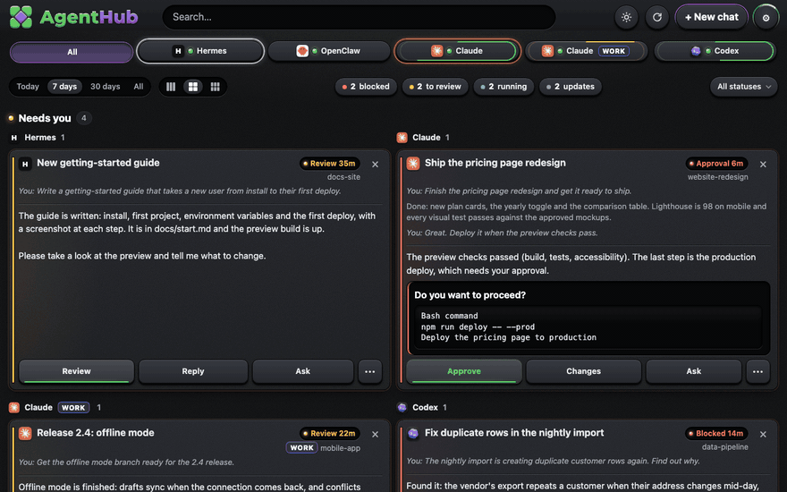
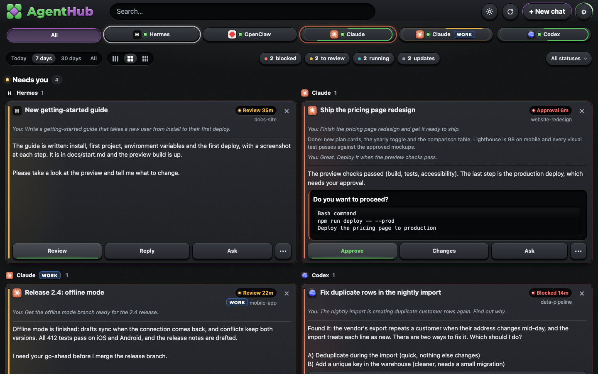
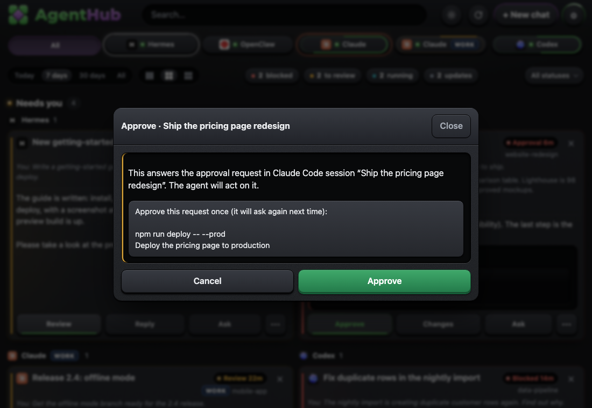
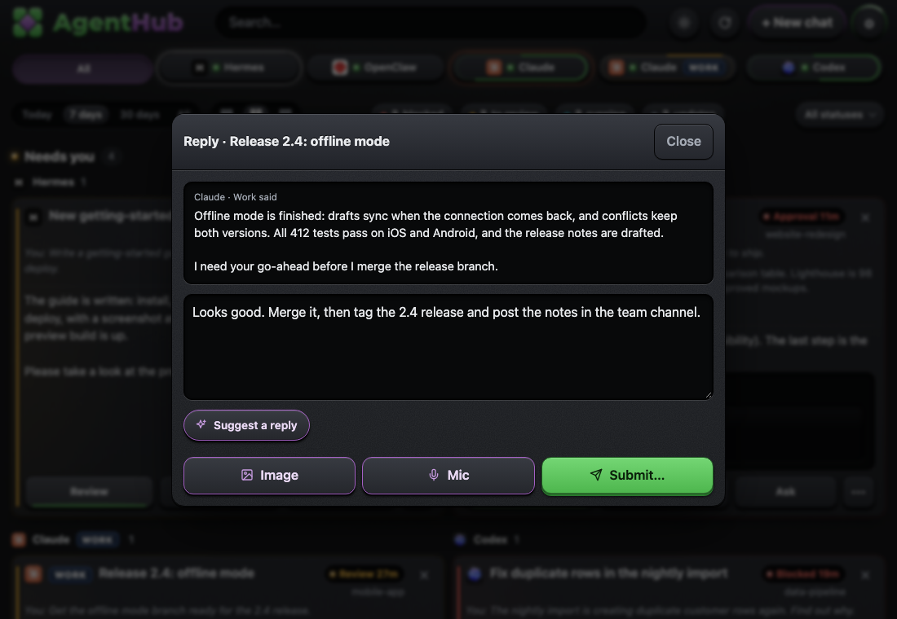
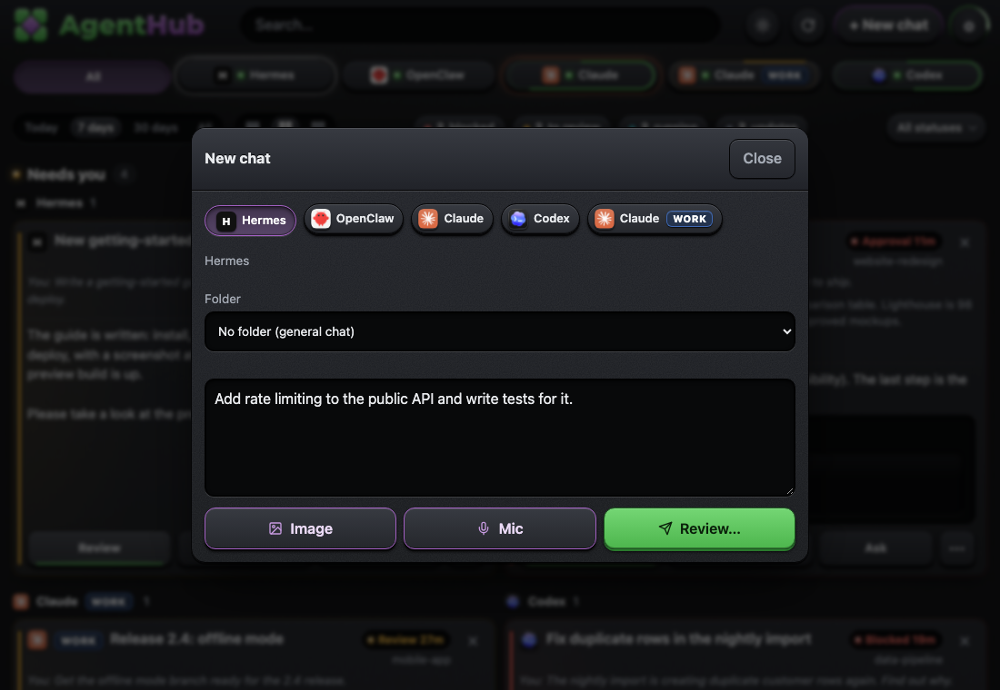
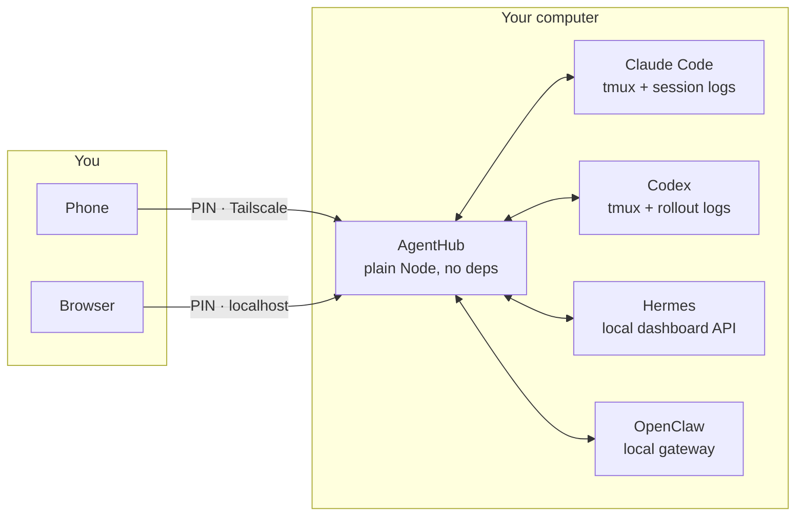

<p align="center">
  
</p>

<h1 align="center">AgentHub</h1>

<p align="center">
  <b>One board for every AI coding agent on your computer.</b><br>
  See what each one is doing, what is waiting on you, and answer from any browser — your phone included.
</p>

<p align="center">
  
  
  
  
  
</p>

<p align="center">
  Works with <b>Claude Code</b> · <b>Codex</b> · <b>Hermes</b> · <b>OpenClaw</b><br>
  <sub>Several accounts of an agent side by side (Claude Code today), and built so more agents plug in: each one is a single small module.</sub>
</p>

<p align="center">
  
</p>

---

## Why

AI coding agents are fast, until they stop and wait for you. An approval here, a question there, a report that needs a
"go ahead". With two or three agents across a few projects, you spend your day checking terminal windows to find out
who is stuck.

**AgentHub puts every chat on one board.** The ones that need you rise to the top with the exact question — and the
exact command an approval would run — right above the buttons. Answer in one tap, from your desk or from your phone on
the couch. Everything else stays quietly out of the way until it matters.

It is a single folder of plain Node. No dependencies, no build step, no account, no cloud: it runs on your computer and
your data never leaves it.

### The story

I was looking at [SlashVibe](https://kicktraq.com/projects/loda/slashvibe/) on Kickstarter: a neat little desk display
and controller for keeping an eye on your AI agents. I liked the idea. Then I saw it ships in 2027 and costs a couple of
hundred dollars, and thought: why wait a year and buy another gadget, when the screen I need is already in my pocket?
So I built AgentHub: the same idea, on the phone and computer you already have. Free, open source, and working today.

<p align="center">
  
</p>

## What you can do

### See what needs you, instantly
- **Needs you** collects every chat that is blocked on you or handed you something to review, grouped by agent.
- **At a glance**: live counts of what is blocked, to review, running and updated — each one a one-tap filter.
- **Running cards** say how long the agent has been working and what you asked it.
- A chat you told to pause is parked as *Paused*, not shouting for attention.

### Answer without opening a terminal
- **Approve** permission prompts. The card shows what is asked and the exact command; the confirm sheet shows the full
  terminal screen before anything is pressed.
- **Answer** multiple-choice questions: the options become buttons.
- **Reply** with text, voice (built-in dictation), images (screenshots straight from your phone) and the agent's own
  `/slash` commands, with a helper that lists them.
- **Suggest a reply**: one of your Claude accounts drafts the reply you would most likely send. You edit, you send.
- **Defer** for later, **Continue** a chat that stopped with a report, or **Continue all** stalled chats at once.

### Keep work moving
- **Continue at reset**: a chat that hit a usage limit continues by itself two minutes after the limit resets.
- **Plan usage rings**: each Claude account's and Codex's session and weekly usage drains around its button.
- **New chat** with one or several agents at once, in a project folder.
- **Agents helping agents**: ask any agent a read-only side question about a chat, hand a task to another agent, or
  have Hermes do one thing a chat asked you to do and send the result back.

### Make it yours
- **Light and dark**, or match the device. Two styles: a clean **classic** look and an embossed **tactile** one with
  pressable keys and status lamps.
- **Several accounts of the same agent** side by side (Claude Code today), each marked with its own coloured tag.
- **Phone first**: add it to your Home Screen and it opens full-screen like an app; pull down to refresh.

<details>
<summary><b>Every feature, in one list</b> (there are a lot of small ones)</summary>

**The board**
- Needs you (blocked and to review, grouped by agent) · Active (running, updates, recently quiet) · every project,
  folded to one line with its counts
- At-a-glance counts (blocked, to review, running, updates), each a one-tap filter
- Filters by agent, status and time window (today, 7 days, 30 days, all), and search (press <kbd>/</kbd>)
- 3, 4 or 6 cards per screen; cards fit their content and show the end of the latest reply
- Projects from your folders, with groups (several folders as one project), folders to leave out, and Hermes kanban
  boards mapped to projects; finished chats and quiet projects can fold away
- Closed view: close a card you're done with and it comes back by itself when something new happens; reopen any time
- The triage page (`/triage`, `/triage.txt`): a read-only plain-text summary of what needs you

**Answering**
- Approve permission prompts, with the question and the exact command on the card and the full terminal screen
  before you confirm; Request changes instead
- Multiple-choice questions as buttons, pick-several questions as tick boxes, a free-text row, and long lists of
  decisions answered one at a time
- Reply with text, voice dictation, up to four images, and the agent's own `/slash` commands (with a helper)
- Suggest a reply: drafted by one of your Claude accounts, never sent without you
- Review: open what the agent made (links get screenshot previews), then approve or ask for changes
- Defer (the agent is told to hold off; the card moves to Closed) and Resume; End a chat
- A chat you paused yourself is parked as Paused, not counted as waiting on you

**Keeping work moving**
- Continue a chat that stopped with a report, with a five-second Undo; Continue all at once
- Continue at reset: a chat stopped by a usage limit continues two minutes after the limit resets (cancellable)
- Plan-usage rings on each Claude account and Codex: session and weekly usage drain around the button, amber from 75%,
  red from 90%; press and hold for the numbers and reset times
- New chat with one agent or several at once, in a project folder, with a model of your choice
- Ask any agent a read-only side question about a chat
- Hand a task off to another agent, or have Hermes do one thing a chat asked you to do and send the result back

**Agents and health**
- A status light on every agent button (ready, degraded, down) and a health ring on the settings button that shows the
  board's last read at a glance
- Press and hold an agent for its details, to re-check it, to restart the Hermes or OpenClaw gateway, or to hide it on
  this device
- Several Claude Code accounts side by side, each with its own coloured tag; read-only folders of tool sessions shown
  with their own label
- Agent versions in Settings, with a note when an update is available (AgentHub never updates your agents)
- A welcome that finds your agents and says exactly what each one needs next; Detect again any time

**Your look**
- Light, dark or match the device; classic or tactile style; per device
- Account tags in colour; the tactile style has its own embossed logo

**Phone and computer**
- Home Screen app (full screen), pull down to refresh, 44px touch targets, works over Tailscale with HTTPS
- The page updates itself when AgentHub is updated
- Start with your computer (launchd on macOS, systemd on Linux) in one click; restart the board from Settings
- `bin/ah` to start answerable Claude Code and Codex sessions from a terminal
- A demo mode with made-up agents (`npm run demo`)

**Safety**
- A PIN for every device, action tokens, Origin checks, a rate limit, local-only listening
- Confirmation before anything is sent, every action logged, menus never answered blindly, never types into a shell
- Zero dependencies, no telemetry, and a privacy check for anything personal before you share the code

</details>

<table>
  <tr>
    <td width="50%"></td>
    <td width="50%"></td>
  </tr>
  <tr>
    <td><b>Approve</b> — the sheet says exactly what will happen, and the button says what it does.</td>
    <td><b>Reply</b> — type, dictate, attach a screenshot, or let it suggest the reply.</td>
  </tr>
  <tr>
    <td></td>
    <td></td>
  </tr>
  <tr>
    <td><b>Light mode</b>, tactile style.</td>
    <td><b>New chat</b> — one agent or several at once, in a project folder.</td>
  </tr>
</table>

<p align="center">
  
  &nbsp;&nbsp;
  
</p>

## Try it in one minute — no agents needed

```bash
git clone https://github.com/jalywebops-code/agenthub.git
cd agenthub
npm run demo               # then open http://localhost:4410
```

The real board with made-up agents, projects and chats in every state. Approve, answer or reply and the demo agent
"works" for a few seconds, then reports back. It needs no PIN and no agents, listens only on your computer, and keeps
its data in a throwaway folder — it never reads or changes anything real. (Every screenshot here comes from it.)

## Install

**Needs:** macOS or Linux · Node.js 20+ · tmux · at least one of Claude Code, Codex, Hermes or OpenClaw.
Optional: Tailscale (phone access), Chrome or Chromium (link previews).

```bash
git clone https://github.com/jalywebops-code/agenthub.git
cd agenthub
npm start                  # then open http://localhost:4400
```

A short **welcome** takes it from there: choose the PIN every device logs in with, see where each of your agents stands
(ready, needs setup, not running, not installed) with the exact next step for each, and make AgentHub start with your
computer in one click. On a server you reach over SSH, `npm run set-pin` and `npm run setup` do the same in the terminal.

The board answers Claude Code and Codex chats that run inside tmux: start them with **New chat** on the board, or with
`bin/ah claude <folder>` / `bin/ah codex <folder>` in a terminal. Chats started elsewhere show read-only.

## How it works



- **Each agent is a lane** that reads what the agent already writes: Claude Code's and Codex's session logs, Hermes's
  dashboard, OpenClaw's gateway. Nothing is installed into your agents and nothing about them is changed.
- **Answering** goes the way you would: Claude Code and Codex through their tmux terminal, Hermes and OpenClaw through
  their own local gateways.
- **The board** reads every lane every 30 seconds (and right after anything you do), sorts each chat into Needs you,
  Active and the rest, and the page checks for changes every 5 seconds — an unchanged board costs a few bytes.
- **No database, no cloud.** A handful of small JSON files in `.data/` hold your setup, PIN hash and history.
- **More agents plug in.** Each agent is one module in `lib/lanes/` with the same small set of functions (read its
  chats, send a reply, answer a menu, start a chat). Supporting another agent — or several accounts of one — means
  writing one, not changing the board.

## Built to be trusted with your terminals

An app that can press keys in your agents' terminals has to be careful. These are the decisions behind it:

- **Nothing is sent without a confirmation**, and every confirm sheet says exactly what will happen in plain words.
- **Menus are never answered blindly.** Right before acting, the board re-reads the screen and only acts if it is still
  exactly the menu you were shown. It refuses menus it can't read safely, plan approvals, update prompts, and any menu
  where Esc could quit the agent.
- **It never types into a shell.** If an agent quit and its terminal is back at a prompt, your reply is refused, not
  run as a command. Control characters are stripped from everything it pastes, each send uses its own paste buffer, and
  actions on one terminal take turns.
- **Agent text can't steer it.** The approval summary only trusts structure an agent can't fake; anything unexpected
  falls back to showing you the raw screen.
- **A PIN for every device**, stored as a salted scrypt hash, with signed HttpOnly cookies, a per-login action token,
  Origin checks and a rate limit that survives restarts.
- **It listens only on your computer** and the private networks you choose (Tailscale, optionally home Wi-Fi). It is
  never meant for the open internet, and the docs say so plainly.
- **Every action is logged** in `.data/actions.log`.
- **Zero dependencies** means zero supply-chain surprises: every line that runs is in this repository.
- **Your data stays private.** No telemetry, no accounts. `.data/` and `private/` never leave your computer, and
  `npm run privacy-check` lists anything personal before you share a copy of the code.

## Made with care

- **Phone first.** 44px touch targets, a sticky header, bottom sheets with room for the iPhone home bar, pull to
  refresh, voice input.
- **Accessible.** WCAG 2.1 AA contrast in light and dark, full keyboard use (cards open with Enter, focus survives
  refreshes, Tab follows the screen), screen-reader labels, and reduced motion respected.
- **Light on your machine.** The page downloads the board only when something changed (otherwise the answer is a few
  bytes), animations are kept small, and one read of each agent is shared by every device.
- **Tested.** Nearly 300 tests, including end-to-end tests against a real server and a fake terminal that records every
  key, so no test can ever press a key in a real session.

## FAQ

**Does it need an API key or an account?** No. It reads what your agents already write on your computer and answers
through the same terminals and gateways you use.

**Will it approve things on its own?** Never. Every action is yours, confirmed, and logged.

**Can I use it from my phone away from home?** Yes, through Tailscale (free for personal use): encrypted, and only
your own devices can reach it. See [phone access](docs/phone-access.md).

**Windows?** Not yet: macOS and Linux (a desktop, or a server such as a cloud droplet).

**Does it slow my agents down?** No. It reads their logs and talks to them only when you act.

## Guides

- [Setting up](docs/setup.md): install, the service, Settings, which files stay private.
- [Agents](docs/agents.md): what each card can do, tmux, several Claude accounts, plan usage, Hermes, OpenClaw.
- [Phone access](docs/phone-access.md): Tailscale, HTTPS, the Home Screen app, home Wi-Fi.
- [Security](docs/security.md): the PIN, who can act, what leaves your computer.

## Development

```bash
npm test                   # the test suite (node --test, no dependencies)
npm run demo               # the board with made-up agents, for working on the page
npm run check              # read every agent once, without starting the server
npm run privacy-check      # anything personal in the files you would share
```

Issues and pull requests are welcome. Please keep it dependency-free, and run `npm test` and `npm run privacy-check`
before sending a change.

## Not affiliated

AgentHub is an independent project. It is not made by or affiliated with Anthropic, OpenAI, Nous Research or the makers
of Hermes or OpenClaw; their names are used only to say which agents it works with.

## License

MIT © 2026 Jaly Web Studio. See [LICENSE](LICENSE).
