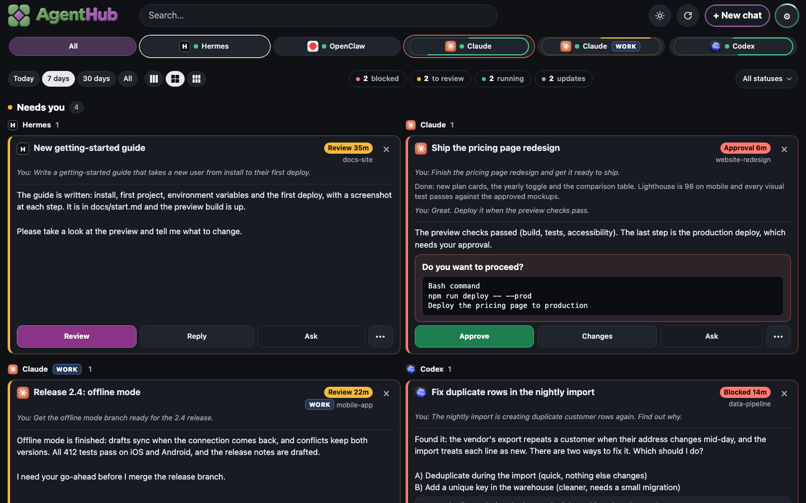
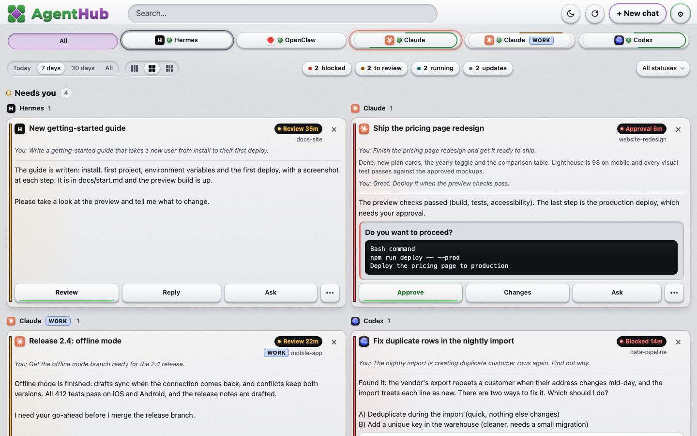
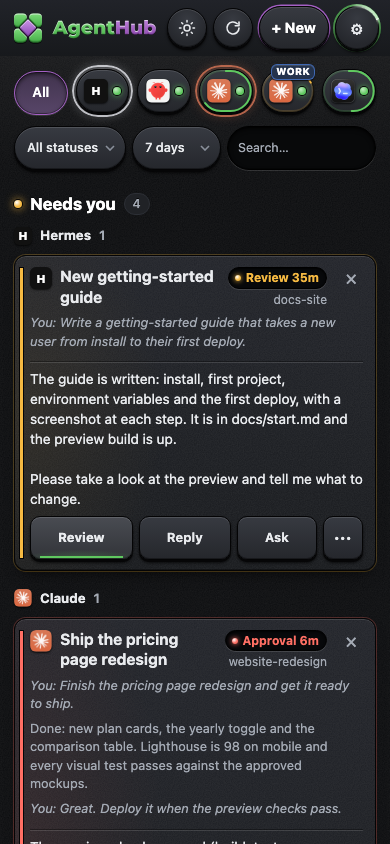

# AgentHub

A control board for the AI coding agents on your own computer: **Claude Code** (one or more accounts), **Codex**,
**Hermes** and **OpenClaw**. It shows what each agent is doing and what is waiting on you, and lets you answer from any
browser, phone included: approve, answer, reply, push a stalled chat on, hand work to another agent.

Plain Node with no dependencies, no build step and no cloud: everything runs and stays on your computer.


| Dark | Light, tactile style | Phone |
|---|---|---|
|  |  |  |

*All screenshots come from the built-in demo (`npm run demo`): made-up agents and chats.*

## What it does

- **Needs you:** every chat that is blocked on you or handed you something to review, grouped by agent, with the
  question (and the exact command an approval would run) right above the buttons, and enough of the conversation to
  answer without opening the agent's own window.
- **Answer from the card:** Approve, Answer (multiple-choice questions become buttons), Reply with text, voice or
  images, Review what an agent made, Defer for later.
- **Keep work moving:** Continue a chat that stopped with a report, or have it continue by itself after a usage limit
  resets. See each Claude account's and Codex's plan usage drain on its button.
- **Agents helping agents:** Ask any agent a side question about a chat, Hand off a task, or have Hermes do one thing
  a chat asked you to do and send the result back.
- **New chat** with one or several agents at once, in a project folder.
- **Phone first:** works as a Home Screen app over Tailscale; nothing is sent without a confirmation.
- **Your look:** light or dark (or match the device), and a classic flat style or an embossed "tactile" one.
- **At a glance:** live counts of what is blocked, to review, running and updated, each a one-tap filter. Several
  Claude accounts are told apart by a coloured tag.
- **Triage page:** `/triage` (or `/triage.txt`) is a read-only summary of what needs you, for another tool or a quick
  look. It has no buttons and sends nothing.

## Requirements

- macOS or Linux (a desktop, or a server such as a cloud droplet).
- Node.js 20 or newer, and tmux (`brew install tmux` on macOS, `sudo apt install tmux` on Debian or Ubuntu).
- At least one of: Claude Code, Codex, Hermes, OpenClaw.
- Optional: Tailscale for phone access, Google Chrome or Chromium for link previews.

## Quick start

```bash
git clone https://github.com/jalywebops-code/agenthub.git
cd agenthub
npm start                  # then open http://localhost:4400
```

The first time, a short **welcome** walks you through it: choose the PIN every device logs in with, see where each of
your agents stands (ready, needs setup, not running, not installed) with the exact next step for each, and optionally
make AgentHub start with your computer. Everything else is in **Settings**, and the welcome is there again under
Settings → Agents → Setup guide. On a server you reach over SSH, `npm run set-pin` and `npm run setup` do the same in
the terminal ([more](docs/setup.md#on-a-server)).

### Try it without any agents

```bash
npm run demo               # then open http://localhost:4410
```

The real board with made-up agents, projects and chats in every state: an approval, a question with options, work to
review, a paused usage limit, running and finished chats. Approve, answer or reply and the demo agent works for a few
seconds, then reports back. No PIN, no agents needed; it only listens on this computer and keeps its data in a
throwaway temp folder, so it never reads or changes a real setup. Add `?clean` to the address to hide the Demo tag for
screenshots.

The board can answer Claude Code and Codex chats that run inside tmux: start them with **New chat** on the board, or
with `bin/ah claude <folder>` / `bin/ah codex <folder>` in a terminal. Other chats show on the board read-only.

## Guides

- [Setting up](docs/setup.md): install, the service, Settings, which files stay private.
- [Agents](docs/agents.md): what each card can do, tmux, several Claude accounts, plan usage, Hermes, OpenClaw.
- [Phone access](docs/phone-access.md): Tailscale, HTTPS, the Home Screen app, home Wi-Fi.
- [Security](docs/security.md): the PIN, who can act, what leaves your computer.

## Safety in short

- Every device logs in with your PIN, and anything that acts needs the board page itself and a confirmation.
- It listens only on your computer and private networks (Tailscale, and home Wi-Fi if you switch it on). Never put it
  on the open internet.
- Terminal menus are never answered blindly: the board re-reads the screen right before acting and refuses menus it
  can't answer safely.
- Every action is logged in `.data/actions.log`.

## Your private folders

`.data/` (setup, PIN hash, logs, caches) and `private/` (your own notes, specs and plans) are ignored by git and never
leave your computer. Before sharing a copy of the code, `npm run privacy-check` lists anything personal it still
finds; add your own names to `private/privacy-patterns.txt` for it to look for.

## Development

```bash
npm test                   # the test suite (node --test, no dependencies)
npm run check              # read every agent once, without starting the server
```

## Not affiliated

AgentHub is an independent project. It is not made by or affiliated with Anthropic, OpenAI, Nous Research or the
makers of Hermes or OpenClaw; their names are used only to say which agents it works with.

## License

MIT. See [LICENSE](LICENSE).
